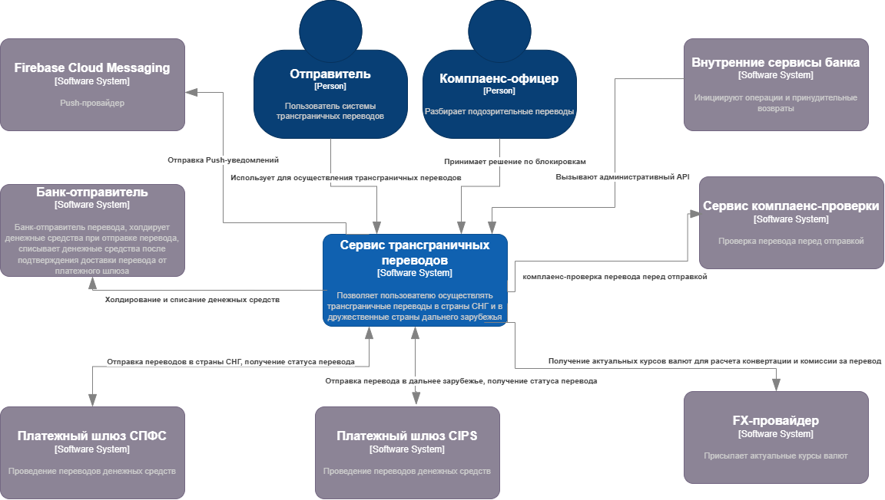
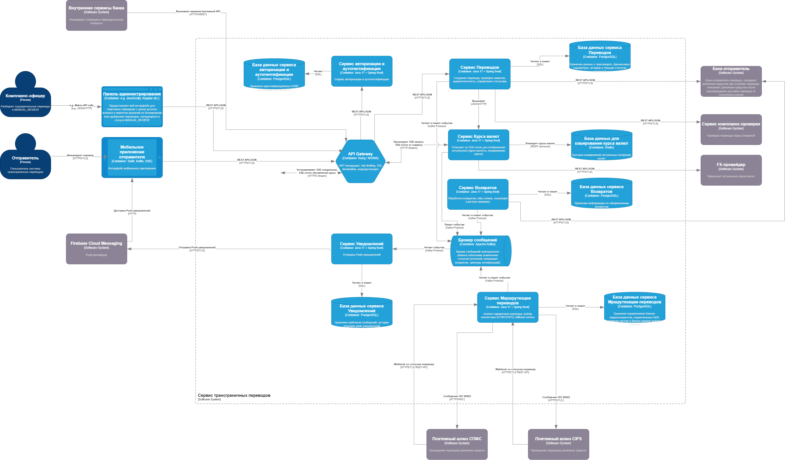

# Архитектура сервиса трансграничных переводов

## 1. Введение

### 1.1. Назначение документа

Документ описывает архитектурные решения сервиса трансграничных переводов: компоненты, их взаимодействие, интеграции с внешними системами, технологический стек и ключевые проектные решения.

Документ предназначен для команды разработки, архитекторов и DevOps-инженеров

### 1.2. Описание значимости артефакта

| Раздел | Содержание |
| --- | --- |
| **Процесс и контекст использования** | Этап проектирования архитектуры. Применяется при выборе технологий, проектировании компонентов и интеграций |
| **Цель создания** | Зафиксировать архитектурные решения, компоненты системы, их взаимодействие и интеграции с внешними системами |
| **Что становится определено** | Архитектурный стиль, компоненты системы, интеграции, потоки данных, технологический стек |
| **Пользователи артефакта** | Архитекторы, разработчики, DevOps-инженеры, технические лиды |
| **Использование в дальнейшем** | Основа для проектирования API, модели данных, развёртывания инфраструктуры |
| **Последствия отсутствия** | Риск несогласованности компонентов, дублирования функционала, проблем с интеграциями |

### 1.3. Область применения

Архитектура охватывает все компоненты, необходимые для реализации функционала трансграничных переводов:

* Сервис создания и обработки переводов
* Сервис маршрутизации платежей
* Обработка вебхуков от платёжных шлюзов
* Возврат средств
* Уведомления пользователей
* Трансляция курсов валют через SSE

## 3. Диаграммы C4

### 3.1. Уровень С1. Контекст

Показывает систему в контексте внешних акторов и систем.

### 3.2. Уровень С2. Контейнеры

Показывает систему на уровне контейнеров и их взаимодействие

## 4. Архитектурная стратегия

Для сервиса трансграничных переводов выбрана микросервисная архитектура, потому что:

1. Независимое масштабирование - каждый сервис можно масштабировать отдельно в зависимости от операционной нагрузки
2. Разделение ответственности - каждый сервис отвечает за свою строго изолированную доменную область (Переводы, Маршрутизация, Возвраты, Уведомления, Курсы Валют)
3. Технологическая гибкость - возможность использовать оптимальный стек технологий и библиотек для конкретных задач
4. Отказоустойчивость - технический сбой или аварийное падение одного сервиса не влияет на прохождение и обработку транзакций в других изолированных компонентах системы
5. Интеграция с внешними системами - каждый сервис может иметь свою обособленную интеграцию (МС Переводов интегрирован с Банком-отправителем и Сервисом комплаенса, а МС Маршрутизации — со шлюзами СПФС/CIPS)

### Ключевые архитектурные решения

1. API Gateway - единая точка входа для клиентских и внутренних запросов, обеспечивающая сквозную маршрутизацию, авторизацию (JWT/ApiKeyAuth) и защиту бэкенда
2. Apache Kafka - брокер сообщений для асинхронной обработки событий между микросервисами, гарантирующий строгую упорядоченность доставки через ключи партиционирования
3. Server-Sent Events (SSE) - технология однонаправленного стриминга данных по протоколу HTTP для трансляции изменений курса валют на мобильное приложение в реальном времени
4. Redis - база данных для кэширования актуальных котировок
5. PostgreSQL - реляционная БД для каждого сервиса для изоляции данных
6. Transactional Outbox - паттерн гарантированной асинхронной доставки событий в брокер Kafka, исключающий потерю сообщений при временной недоступности сети или инфраструктуры

### Обоснование нагрузки и количество экземпляров

1. Интенсивность бизнес-транзакций - целевой объем в 50 000 переводов в месяц при стандартном банковском коэффициенте пиковой неравномерности трафика формирует расчетную пиковую нагрузку на создание операций на уровне 0.285 запросов в секунду (RPS)
2. Пропускная способность контура UI - с учетом SSE-стриминга курсов и пагинации списков истории, сопутствующая пиковая нагрузка от мобильных клиентов составляет до 5.77 RPS
3. Инженерный запас прочности - заложенная в требованиях пропускная способность в 100 RPS выступает фактором, гарантирующим стабильность системы при повторных запросах после сбоев внешних шлюзов
4. Развертывание инстансов - для обеспечения целевых 100 RPS каждый ключевой микросервис разворачивается в количестве 4 инстансов
