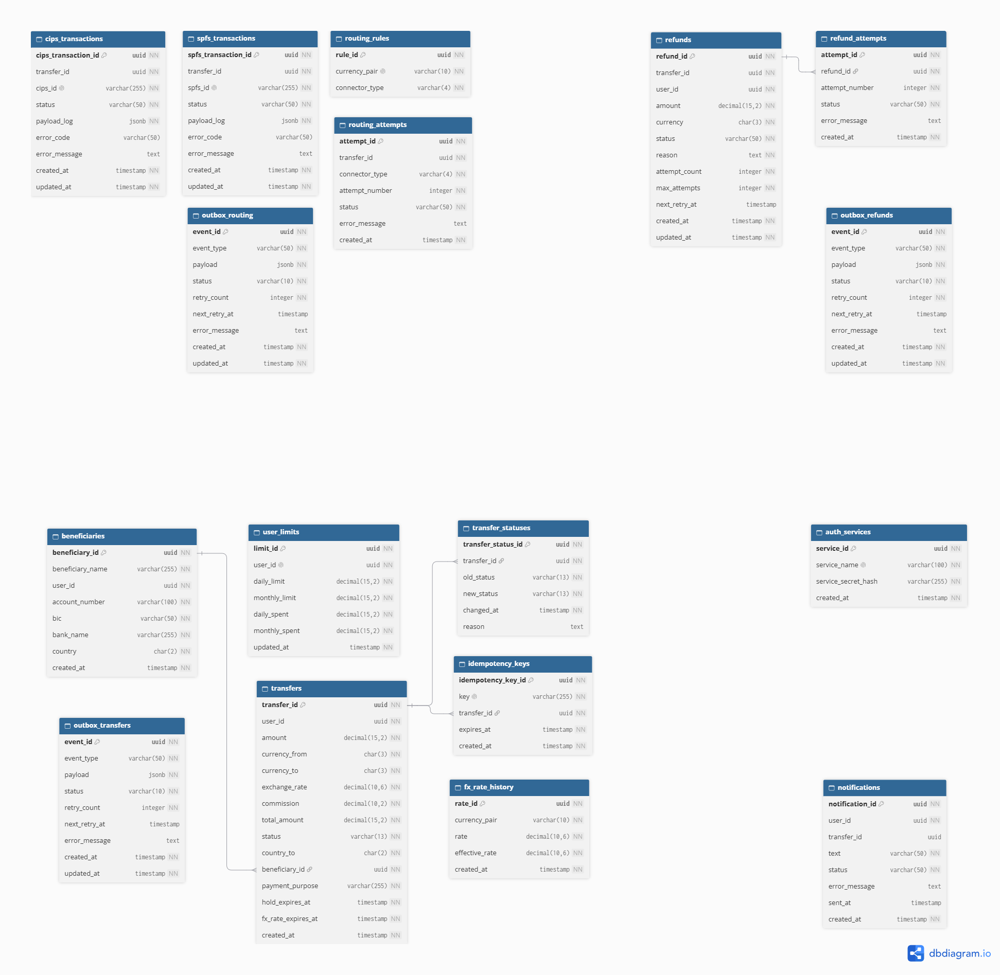

# Описание модели данных сервиса Трансграничных переводов

## 1. Введение

### 1.1. Назначение документа

Данный документ описывает логическую модель данных сервиса трансграничных переводов в архитектуре микросервисов. Документ определяет схемы баз данных каждого микросервиса, таблицы, атрибуты, ограничения целостности и связи между сущностями.

### 1.2. Ограничения

1. Данные о пользователях (ФИО, телефоны) не хранятся в базе данных. Пользовательские данные извлекаются из JWT-токена, выданного основной системой банка
2. Каждый микросервис владеет своей базой данных. Межсервисное взаимодействие осуществляется через события Kafka и REST API
3. Redis используется как отдельное хранилище для кэширования курсов валют и не описывается в данном документе
4. Срок хранения данных:

* История статусов переводов - 5 лет (требование ЦБ РФ и 152-ФЗ)
* Логи сообщений коннекторов - 1 год
* История курсов валют - 1 год
* Уведомления - 6 месяцев
* Ключи идемпотентности - 24 часа

Автоматическая очистка через фоновые задачи воркерам микросервисов

### 1.3. Описание значимости артефакта

| Раздел| Содержание|
| -------- | ---------- |
| Процесс и контекст использования | Этап проектирования уровня данных. Применяется при создании схем БД |
| Цель создания | Определить, как хранить данные о переводах, пользователях, транзакциях, маршрутизации и уведомлениях. Обеспечить целостность данных и производительность запросов |
| Что становится определено | Схемы БД каждого микросервиса, таблицы, атрибуты, типы данных |
| Пользователи артефакта | Бэкенд-разработчики, архитекторы, аналитики данных |
| Использование в дальнейшем | Создание таблиц в БД, проектирование API-контрактов |
| Последствия отсутствия | Неправильная структура БД, нарушение целостности данных, невозможность обеспечить идемпотентность и аудит, проблемы с производительностью |

## 2. Общая ER-диаграмма сервиса трансграничных переводов

[Код Диаграммы](КодДиаграммы.md)

## 3. Описание атрибутов БД по микросервисам

### 3.1. Сервис авторизации и аутентификации

Аутентификация пользователей делегирована основной системе банка. Данные о пользователях извлекаются из JWT-токена и не хранятся в БД сервиса переводов. Валидация токена происходит криптографически - проверяется подпись и срок действия без обращения к базе данных.
Сервис авторизации и аутотентификации хранит только сведения о внутренних сервисах банка, которым разрешено обращаться к API сервиса переводов

<u>**Таблица auth_services**</u>

Хранит идентификаторы и зашифрованные ключи внутренних сервисов банка, которые могут обращаться к сервису переводов

| Атрибут | Тип данных | Ограничение | Назначение |
| --- | --- | --- | --- |
| service_id | UUID | PRIMARY KEY, NOT NULL | Уникальный идентификатор сервиса |
| service_name | VARCHAR(100) | NOT NULL, UNIQUE | Название сервиса |
| service_secret_hash | VARCHAR(255) | NOT NULL | Зашифрованный ключ сервиса |
| created_at | TIMESTAMP | NOT NULL, DEFAULT NOW() | Дата регистрации сервиса |

### 3.2. Сервис переводов

Отвечает за весь жизненный цикл перевода: от создания заявки до финального статуса. Хранит все финансовые данные, лимиты пользователей, справочник бенефициаров и обеспечивает идемпотентность операций

<u>**Таблица transfers**</u>

Хранит информацию о переводах

| Атрибут | Тип данных | Ограничение | Назначение |
| --- | --- | --- | --- |
| transfer_id | UUID | PRIMARY KEY, NOT NULL | Уникальный идентификатор перевода |
| user_id | UUID | NOT NULL | Внешний ID отправителя |
| amount | DECIMAL(15,2) | NOT NULL | Сумма перевода |
| currency_from | CHAR(3) | NOT NULL, DEFAULT 'RUB' | Валюта отправителя |
| currency_to | CHAR(3) | NOT NULL | Валюта получателя |
| exchange_rate | DECIMAL(10,6) | NOT NULL | Зафиксированный курс |
| commission | DECIMAL(10,2) | NOT NULL | Комиссия за перевод |
| total_amount | DECIMAL(15,2) | NOT NULL | Итоговая сумма к списанию |
| status | VARCHAR(13) | NOT NULL, CHECK (status IN ('PENDING', 'APPROVED', 'PROCESSING', 'COMPLETED', 'BLOCKED', 'REJECTED', 'FAILED', 'MANUAL_REVIEW', 'REFUNDED')) | Текущий статус перевода |
| country_to | CHAR(2) | NOT NULL | Страна получателя |
| beneficiary_id | UUID | NOT NULL, FK →  beneficiaries.beneficiary_id | Связь с бенефициаром |
| payment_purpose | VARCHAR(255) | NOT NULL | Цель платежа |
| hold_expires_at | TIMESTAMP | NOT NULL | Время истечения холдирования |
| fx_rate_expires_at | TIMESTAMP | NOT NULL | Время истечения периода зафиксированного курса валюты |
| created_at | TIMESTAMP | NOT NULL, DEFAULT NOW() | Дата создания перевода |

<u>**Таблица transfer_statuses**</u>

Хранит информацию о статусах переводов

| Атрибут | Тип данных | Ограничение | Назначение |
| --- | --- | --- | --- |
| transfer_status_id | UUID | PRIMARY KEY, NOT NULL | Уникальный идентификатор статуса перевода |
| transfer_id | UUID | NOT NULL, FK → transfers.transfer_id ON DELETE CASCADE | Связь с переводом |
| old_status | VARCHAR(13) | NOT NULL | Предыдущий статус |
| new_status | VARCHAR(13) | NOT NULL | Новый статус |
| changed_at | TIMESTAMP | NOT NULL, DEFAULT NOW() | Дата и время изменения |
| reason | TEXT | | Причина, по которой перевод был заблокирован или отклонен |

<u>**Таблица idempotency_keys**</u>

Обеспечивает идемпотентность операций создания перевода. Ключ генерируется клиентом и хранится 24 часа

| Атрибут | Тип данных | Ограничение | Назначение |
| --- | --- | --- | --- |
| idempotency_key_id | UUID | PRIMARY KEY, NOT NULL| Уникальный идентификатор ключа |
| key | VARCHAR(255) | UNIQUE, NOT NULL | Значение ключа идемпотентности из заголовка запроса |
| transfer_id | UUID | FK → transfers.transfer_id ON DELETE SET NULL | Связанный перевод (при удалении перевода поле обнуляется) |
| expires_at | TIMESTAMP | NOT NULL, DEFAULT NOW() + INTERVAL '24 hours' | Время истечения ключа |
| created_at | TIMESTAMP | NOT NULL, DEFAULT NOW() | Дата создания |

<u>**Таблица user_limits**</u>

Хранит информацию о лимитах отправителя на переводы

| Атрибут | Тип данных | Ограничение | Назначение |
| --- | --- | --- | --- |
| limit_id | UUID | PRIMARY KEY, NOT NULL | Уникальный идентификатор |
| user_id | UUID | UNIQUE, NOT NULL | Внешний ID отправителя |
| daily_limit | DECIMAL(15,2) | NOT NULL, DEFAULT 100 000 | Суточный лимит |
| monthly_limit | DECIMAL(15,2) | NOT NULL, DEFAULT 1 000 000 | Месячный лимит |
| daily_spent | DECIMAL(15,2) | NOT NULL, DEFAULT 0 | Потрачено за сегодня |
| monthly_spent | DECIMAL(15,2) | NOT NULL, DEFAULT 0 | Потрачено за месяц |
| updated_at | TIMESTAMP | NOT NULL, DEFAULT NOW() | Дата обновления |

<u>**Таблица beneficiaries**</u>

Содержит информацию о получателе перевода

| Атрибут | Тип данных | Ограничение | Назначение |
| --- | --- | --- | --- |
| beneficiary_id | UUID | PRIMARY KEY, NOT NULL | Уникальный идентификатор бенефициара |
| beneficiary_name | VARCHAR(255) | NOT NULL | Имя бенефициара |
| user_id | UUID | NOT NULL | Внешний ID отправителя |
| account_number | VARCHAR(100) | NOT NULL | Номер счёта / IBAN |
| bic | VARCHAR(50) | NOT NULL | Код банка |
| bank_name | VARCHAR(255) | NOT NULL | Название банка |
| country | CHAR(2) | NOT NULL | Страна банка |
| created_at | TIMESTAMP | NOT NULL, DEFAULT NOW() | Дата создания |

<u>**Таблица fx_rate_history**</u>

Хранит историю всех изменений курсов валют

| Атрибут | Тип данных | Ограничение | Назначение |
| --- | --- | --- | --- |
| rate_id | UUID | PRIMARY KEY, NOT NULL | Уникальный идентификатор |
| currency_pair | VARCHAR(10) | NOT NULL | Валютная пара (например, 'RUB/KZT') |
| rate | DECIMAL(10,6) | NOT NULL | Базовый курс |
| effective_rate | DECIMAL(10,6) | NOT NULL | Курс с маржей |
| created_at | TIMESTAMP | NOT NULL, DEFAULT NOW() | Дата фиксации курса |

### 3.3. Сервис маршрутизации переводов

Отвечает за выбор платёжного маршрута (СПФС или CIPS) в зависимости от валютной пары, отправку платежа во внешний шлюз и обработку вебхуков о статусе

<u>**Таблица routing_rules**</u>

Хранит правила выбора коннектора по валютной паре

| Атрибут | Тип данных | Ограничение | Назначение |
| --- | --- | --- | --- |
| rule_id | UUID | PRIMARY KEY, NOT NULL | Уникальный идентификатор |
| currency_pair | VARCHAR(10) | NOT NULL, CHECK (currency_pair  IN('RUB/KZT', 'RUB/CNY', 'KZT/RUB', 'CNY/RUB')) | Валютная пара |
| connector_type | VARCHAR(4) | NOT NULL, CHECK (connector_type IN ('SPFS', 'CIPS')) | Тип коннектора |

<u>**Таблица routing_attempts**</u>

Хранит историю попыток отправки перевода

| Атрибут | Тип данных | Ограничение | Назначение |
| --- | --- | --- | --- |
| attempt_id | UUID | PRIMARY KEY, NOT NULL | Уникальный идентификатор |
| transfer_id | UUID | NOT NULL | Идентификатор перевода |
| connector_type | VARCHAR(4) | NOT NULL | Использованный коннектор |
| attempt_number | INTEGER | NOT NULL, DEFAULT 1 | Номер попытки |
| status | VARCHAR(7) | NOT NULL, CHECK (status IN ('PENDING', 'SUCCESS', 'FAILED', 'TIMEOUT')) | Статус попытки |
| error_message | TEXT | | Сообщение об ошибке |
| created_at | TIMESTAMP | NOT NULL, DEFAULT NOW() | Дата создания |

<u>**Таблица spfs_transactions**</u>

Хранит информацию о транзакциях, отправленных через платёжную систему СПФС

| Атрибут | Тип данных | Ограничение | Назначение |
| --- | --- | --- | --- |
| spfs_transaction_id | UUID | PRIMARY KEY, NOT NULL | Уникальный идентификатор транзакции |
| transfer_id | UUID | NOT NULL | Идентификатор перевода |
| spfs_id | VARCHAR(255) | NOT NULL | Внешний ID транзакции в СПФС |
| status | VARCHAR(15) | NOT NULL | Статус транзакции |
| payload_log | JSONB | NOT NULL | Сырой ответ шлюза |
| error_code | VARCHAR(50) | | Код ошибки |
| error_message | TEXT | | Сообщение об ошибке |
| created_at | TIMESTAMP | NOT NULL, DEFAULT NOW() | Дата создания |
| updated_at | TIMESTAMP | NOT NULL, DEFAULT NOW() | Дата обновления |

<u>**Таблица cips_transactions**</u>

Хранит информацию о транзакциях, отправленных через платёжную систему CIPS

| Атрибут | Тип данных | Ограничение | Назначение |
| --- | --- | --- | --- |
| cips_transaction_id | UUID | PRIMARY KEY, NOT NULL | Уникальный идентификатор |
| transfer_id | UUID | NOT NULL | Идентификатор перевода |
| cips_id | VARCHAR(255) | NOT NULL | Внешний ID транзакции в CIPS |
| status | VARCHAR(15) | NOT NULL | Статус транзакции |
| payload_log | JSONB | NOT NULL | Сырой ответ шлюза |
| error_code | VARCHAR(50) | | Код ошибки |
| error_message | TEXT | | Сообщение об ошибке |
| created_at | TIMESTAMP | NOT NULL, DEFAULT NOW() | Дата создания |
| updated_at | TIMESTAMP | NOT NULL, DEFAULT NOW() | Дата обновления |

### 3.4. Сервис возвратов

Отвечает за автоматический возврат средств отправителю при невозможности провести перевод (ошибка шлюза, отклонение комплаенсом, истечение срока холда). Реализует retry-логику с экспоненциальной задержкой и эскалацию в поддержку при исчерпании попыток

<u>**Таблица refunds**</u>

Хранит информацию о заявке на возврат средств по конкретному переводу

| Атрибут | Тип данных | Ограничение | Назначение |
| --- | --- | --- | --- |
| refund_id | UUID | PRIMARY KEY, NOT NULL | Уникальный идентификатор возврата |
| transfer_id | UUID | NOT NULL | Идентификатор перевода |
| user_id | UUID | NOT NULL | Внешний ID отправителя |
| amount | DECIMAL(15,2) | NOT NULL | Сумма возврата |
| currency | CHAR(3) | NOT NULL | Валюта возврата |
| status | VARCHAR(10) | NOT NULL, CHECK (status IN ('PENDING', 'PROCESSING', 'COMPLETED', 'FAILED', 'ESCALATED')) | Статус возврата |
| reason | TEXT | NOT NULL | Причина возврата |
| attempt_count | INTEGER | NOT NULL, DEFAULT 0 | Количество попыток |
| max_attempts | INTEGER | NOT NULL, DEFAULT 10 | Максимум попыток |
| next_retry_at | TIMESTAMP | | Время следующей попытки |
| created_at | TIMESTAMP | NOT NULL, DEFAULT NOW() | Дата создания |
| updated_at | TIMESTAMP | NOT NULL, DEFAULT NOW() | Дата обновления |

<u>**Таблица refund_attempts**</u>

Хранит историю каждой попытки выполнить возврат

| Атрибут | Тип данных | Ограничение | Назначение |
| --- | --- | --- | --- |
| attempt_id | UUID | PRIMARY KEY, NOT NULL | Уникальный идентификатор попытки|
| refund_id | UUID | NOT NULL, FK → refunds.refund_id ON DELETE CASCADE | Идентификатор возврата |
| attempt_number | INTEGER | NOT NULL | Номер попытки |
| status | VARCHAR(7) | NOT NULL, CHECK (status IN ('PENDING', 'SUCCESS', 'FAILED')) | Статус попытки |
| error_message | TEXT | | Сообщение об ошибке |
| created_at | TIMESTAMP | NOT NULL, DEFAULT NOW() | Дата создания |

### 3.5. Сервис уведомлений

Хранит информацию о доставке Push-уведомлений отправителю при изменении статуса перевода. Шаблоны текстов хранятся в конфигурации, в БД — только факт отправки

<u>**Таблица notifications**</u>

| Атрибут | Тип данных | Ограничение | Назначение |
| --- | --- | --- | --- |
| notification_id | UUID | PRIMARY KEY, NOT NULL | Уникальный идентификатор |
| user_id | UUID | NOT NULL | Внешний ID отправителя |
| transfer_id | UUID | | Связанный перевод  |
| text | VARCHAR(500) | NOT NULL | Текст отправленного уведомления |
| status | VARCHAR(6) | NOT NULL, CHECK (status IN ('SENT', 'FAILED')) | Статус доставки |
| error_message | TEXT | | Причина ошибки отправки |
| sent_at | TIMESTAMP | | Время фактической отправки |
| created_at | TIMESTAMP | NOT NULL, DEFAULT NOW() | Дата создания |
