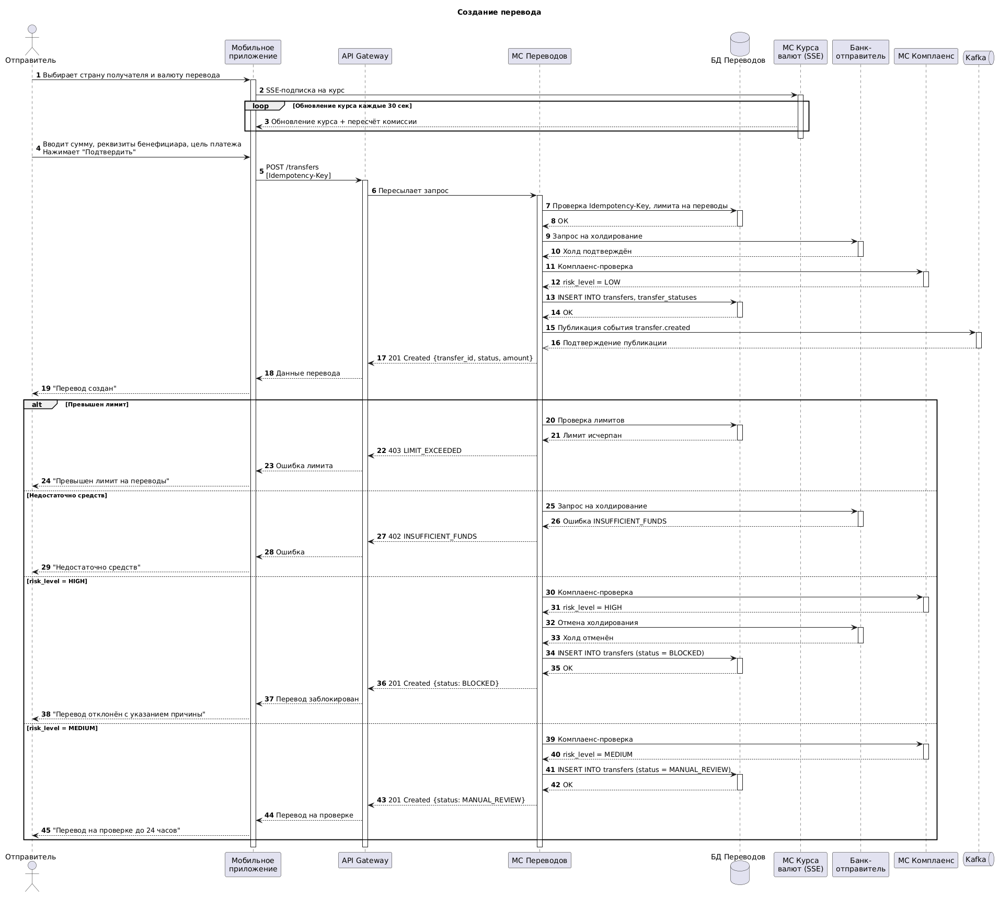

# Описание API-контрактов для реализации функционала сервиса Трансграничных переводов

## 1. Введение

Документ представляет собой техническую спецификацию REST API для реализации функционала трансграничных переводов. Он содержит описание API-контрактов для операций создания перевода, просмотра истории, фиксации курса валют, отмены и возврата средств.

Документ предназначен для команды разработки и команды тестирования.

## 2. Описание значимости артефакта

| Раздел | Содержание |
|--------|------------|
| Процесс и контекст использования | Этап проектирования интеграции между мобильным приложением и бэкенд-сервисами |
| Цель создания | Зафиксировать контракты, обеспечить единое понимание структуры запросов/ответов между командами |
| Что становится определено | Эндпоинты, форматы запросов/ответов, коды ошибок, логика обработки |
| Пользователи артефакта | Frontend-разработчики, Backend-разработчики, тестировщики |
| Использование в дальнейшем | Параллельная разработка мобильного приложения и бэкенда, тестирование |
| Последствия отсутствия | Рассинхронизация мобильного приложения и бэкенда, множественные правки API в процессе разработки |

## 3. Sequence-диаграмма

**Участники**

1. Отправитель — пользователь системы, инициирующий перевод
2. Мобильное приложение отправителя — интерфейс мобильного приложения
3. API Gateway — точка входа, маршрутизатор запросов
4. МС Переводов — микросервис, отвечающий за создание и обработку переводов
5. БД Переводов — база данных сервиса Переводов
6. МС Курса валют — микросервис, отвечающий за трансляцию курсов через SSE
7. МС Комплаенс-проверки — внешний сервис проверки риска
8. Банк-отправитель — система холдирования и списания средств
9. Apache Kafka - брокер сообщений




[Код диаграммы](КодДиаграммы.yml)

## 4. OpenAPI-спецификация

[Спецификация API](API.yml)

```yaml
openapi: 3.0.3
info:
  title: МС Переводов — API сервиса трансграничных переводов
  description: |
    API для управления трансграничными переводами денежных средств.
    Поддерживает операции создания перевода, просмотра истории,
    фиксации курса валют
  version: 1.0.0

servers:
  - url: https://api.crossborder.bank/v1
    description: Основной сервер API системы трансграничных переводов

security:
  - bearerAuth: []

tags:
  - name: transfers
    description: Операции с переводами
  - name: fx
    description: Операции с курсами валют
  
paths:
  /transfers:
    post:
      summary: Создание перевода
      description: |
        Создание заявки на трансграничный перевод.
        Перед созданием проверяются лимиты отправителя,
        валидируются реквизиты бенефициара, фиксируется курс валюты.
        Требуется заголовок Idempotency-Key для предотвращения дублирования
      tags:
        - transfers
      operationId: transferCreation
      parameters:
        - name: Idempotency-Key
          in: header
          description: Уникальный ключ запроса для предотвращения дублирования перевода при повторной отправке
          required: true
          schema:
            type: string
            format: uuid
      requestBody:
        required: true
        content:
          application/json:
            schema:
              $ref: '#/components/schemas/CreateTransferRequest'
      responses:
        '201':
          description: Перевод успешно создан
          headers:
            Location:
              description: URI созданного ресурса
              schema:
                type: string
                format: uri
          content:
            application/json:
              schema:
                $ref: '#/components/schemas/TransferResponse'
        '400':
          description: Некорректный формат счёта/IBAN/BIC
          content:
            application/json:
              schema:
                $ref: '#/components/schemas/ErrorResponse'
              example:
                error:
                  code: INVALID_BENEFICIARY
                  message: Неверные реквизиты бенефициара
        '401':
          $ref: '#/components/responses/Unauthorized'
        '403':
          description: Отправитель не резидент РФ 
          content:
            application/json:
              schema:
                $ref: '#/components/schemas/ErrorResponse'
              example:
                error:
                  code: NON_RESIDENT
                  message: Сервис доступен только для резидентов РФ
        '409':
          description: Дублирующий запрос 
          content:
            application/json:
              schema:
                $ref: '#/components/schemas/ErrorResponse'
              example:
                error:
                  code: DUPLICATE_REQUEST
                  message: Запрос с таким Idempotency-Key уже обработан
        '422':
          description: |
            Превышен лимит, недопустимая валютная пара, 
            сумма перевода меньше минимальной или недостаточно средств
          content:
            application/json:
              schema:
                $ref: '#/components/schemas/ErrorResponse'
              examples:
                AMOUNT_TOO_LOW:
                  summary: Сумма перевода меньше минимальной
                  value:
                    error:
                      code: AMOUNT_TOO_LOW
                      message: Минимальная сумма перевода 1000 RUB
                LIMIT_EXCEEDED:
                  summary: Превышен лимит
                  value:
                    error:
                      code: LIMIT_EXCEEDED
                      message: Превышен суточный/месячный лимит переводов
                INSUFFICIENT_FUNDS:
                  summary: Недостаточно средств
                  value:
                    error:
                      code: INSUFFICIENT_FUNDS
                      message: Недостаточно средств на счете
                      hint: Пополните счет и повторите попытку
                UNSUPPORTED_CURRENCY_PAIR:
                  summary: Неподдерживаемая валютная пара
                  value:
                    error:
                      code: UNSUPPORTED_CURRENCY_PAIR
                      message: Переводы в выбранную валюту недоступны
                FX_RATE_EXPIRED:
                  summary: Курс устарел
                  value:
                    error:
                      code: FX_RATE_EXPIRED
                      message: Срок действия курса истек

    get:
      summary: Получение списка переводов
      description: |
        Позволяет получить список переводов отправителя с фильтрацией по статусу и дате
      tags:
        - transfers
      operationId: transferList
      parameters:
        - name: status
          in: query
          required: false
          schema:
            type: string
            enum: [PENDING, APPROVED, PROCESSING, COMPLETED, BLOCKED, REJECTED, FAILED, MANUAL_REVIEW, REFUNDED]
          description: Фильтр по статусу перевода
        - name: date_from
          in: query
          required: false
          schema:
            type: string
            format: date-time
          description: Фильтр по дате создания (от)
        - name: date_to
          in: query
          required: false
          schema:
            type: string
            format: date-time
          description: Фильтр по дате создания (до)
        - name: page
          in: query
          required: false
          schema:
            type: integer
            minimum: 1
            default: 1
        - name: limit
          in: query
          required: false
          schema:
            type: integer
            minimum: 1
            maximum: 50
            default: 20
      responses:
        '200':
          description: Список переводов
          content:
            application/json:
              schema:
                $ref: '#/components/schemas/TransferListResponse'
        '401':
          $ref: '#/components/responses/Unauthorized'

  /transfers/{transfer_id}:
    get:
      summary: Получение деталей перевода
      description: |
        Детальная информация о переводе: сумма, курс, комиссия, маршрут, статус
      tags:
        - transfers
      operationId: transferDetails
      parameters:
        - name: transfer_id
          in: path
          required: true
          schema:
            type: string
            format: uuid
          description: Уникальный идентификатор перевода
      responses:
        '200':
          description: Детальная информация о переводе
          content:
            application/json:
              schema:
                $ref: '#/components/schemas/TransferDetailResponse'
        '401':
          $ref: '#/components/responses/Unauthorized'
        '403':
          $ref: '#/components/responses/Forbidden'
        '404':
          $ref: '#/components/responses/NotFound'

  /transfers/{transfer_id}/statuses:
    get:
      summary: Получение истории статусов перевода
      description: |
        Полная история изменения статусов перевода с указанием причины и инициатора
      tags:
        - transfers
      operationId: transferStatusHistory
      parameters:
        - name: transfer_id
          in: path
          required: true
          schema:
            type: string
            format: uuid
          description: Уникальный идентификатор перевода
      responses:
        '200':
          description: История статусов перевода
          content:
            application/json:
              schema:
                $ref: '#/components/schemas/TransferStatusListResponse'
        '401':
          $ref: '#/components/responses/Unauthorized'
        '403':
          $ref: '#/components/responses/Forbidden'
        '404':
          $ref: '#/components/responses/NotFound'

  /transfers/{transfer_id}/cancel:
    post:
      summary: Отмена перевода
      description: |
        Отмена перевода отправителем.
        Доступно только для переводов в статусах PENDING или APPROVED.
        Запускает процесс возврата средств.
      tags:
        - transfers
      operationId: transferCancellation
      parameters:
        - name: Idempotency-Key
          in: header
          description: Уникальный ключ запроса для предотвращения дублирования операции отмены
          required: true
          schema:
            type: string
            format: uuid
        - name: transfer_id
          in: path
          required: true
          schema:
            type: string
            format: uuid
          description: Уникальный идентификатор перевода
      requestBody:
        required: true
        content:
          application/json:
            schema:
              type: object
              required:
                - cancellation_reason
              properties:
                cancellation_reason:
                  type: string
                  maxLength: 500
                  description: Причина отмены перевода
      responses:
        '200':
          description: Перевод отменен, запущен процесс возврата средств
          content:
            application/json:
              schema:
                $ref: '#/components/schemas/TransferResponse'
        '400':
          $ref: '#/components/responses/BadRequest'
        '401':
          $ref: '#/components/responses/Unauthorized'
        '403':
          $ref: '#/components/responses/Forbidden'
        '404':
          $ref: '#/components/responses/NotFound'
        '409':
          description: Перевод нельзя отменить в текущем статусе
          content:
            application/json:
              schema:
                $ref: '#/components/schemas/ErrorResponse'
              example:
                error:
                  code: CONFLICT
                  message: Перевод находится в статусе PROCESSING или COMPLETED

  /transfers/{transfer_id}/refund:
    post:
      summary: Инициация возврата средств
      description: |
        Принудительная инициация возврата средств по переводу.
        Используется при ошибках шлюза, отклонении комплаенсом, истечении срока холда
      tags:
        - transfers
      operationId: transferRefund
      parameters:
        - name: Idempotency-Key
          in: header
          description: Уникальный ключ запроса для предотвращения дублирования операции возврата
          required: true
          schema:
            type: string
            format: uuid
        - name: transfer_id
          in: path
          required: true
          schema:
            type: string
            format: uuid
          description: Уникальный идентификатор перевода
      requestBody:
        required: true
        content:
          application/json:
            schema:
              type: object
              required:
                - refund_reason
              properties:
                refund_reason:
                  type: string
                  maxLength: 500
                  description: Причина возврата средств
                force:
                  type: boolean
                  default: false
                  description: Принудительный возврат (игнорирует статус перевода)
      responses:
        '200':
          description: Возврат инициирован
          content:
            application/json:
              schema:
                $ref: '#/components/schemas/RefundResponse'
        '400':
          $ref: '#/components/responses/BadRequest'
        '401':
          $ref: '#/components/responses/Unauthorized'
        '403':
          $ref: '#/components/responses/Forbidden'
        '404':
          $ref: '#/components/responses/NotFound'
        '409':
          description: Перевод уже возвращен 
          content:
            application/json:
              schema:
                $ref: '#/components/schemas/ErrorResponse'

  /fx/rates/{currency_pair}:
    get:
      summary: Получение актуального курса валют
      description: |
        Получение текущего курса валютной пары с учетом маржи.
        Курс обновляется не чаще одного раза в 30 секунд
      tags:
        - fx
      operationId: fxRateDetails
      parameters:
        - name: currency_pair
          in: path
          required: true
          schema:
            type: string
            enum: [RUB/KZT, RUB/CNY]
          description: Валютная пара 
      responses:
        '200':
          description: Актуальный курс валют
          content:
            application/json:
              schema:
                $ref: '#/components/schemas/FxRateResponse'
        '401':
          $ref: '#/components/responses/Unauthorized'
        '404':
          description: Валютная пара не найдена
          content:
            application/json:
              schema:
                $ref: '#/components/schemas/ErrorResponse'
              example:
                error:
                  code: NOT_FOUND
                  message: Валютная пара не поддерживается

  /fx/rates/lock:
    post:
      summary: Фиксация курса валюты
      description: |
        Фиксация текущего курса валютной пары на 15 минут.
        Возвращает идентификатор зафиксированного курса,
        который используется при создании перевода
      tags:
        - fx
      operationId: fxRateLock
      parameters:
        - name: Idempotency-Key
          in: header
          description: Уникальный ключ запроса для предотвращения дублирования фиксации курса
          required: true
          schema:
            type: string
            format: uuid
      requestBody:
        required: true
        content:
          application/json:
            schema:
              $ref: '#/components/schemas/FxRateLockRequest'
      responses:
        '201':
          description: Курс успешно зафиксирован
          content:
            application/json:
              schema:
                $ref: '#/components/schemas/FxRateLockResponse'
        '400':
          $ref: '#/components/responses/BadRequest'
        '401':
          $ref: '#/components/responses/Unauthorized'
        '409':
          description: Курс уже зафиксирован для данной суммы и валютной пары
          content:
            application/json:
              schema:
                $ref: '#/components/schemas/ErrorResponse'

components:
  securitySchemes:
    bearerAuth:
      type: http
      scheme: bearer
      bearerFormat: JWT
      description: |
        JWT токен, полученный от основной системы банка.
        Передавать только по HTTPS в заголовке Authorization: Bearer <token>

  schemas:
    CreateTransferRequest:
      type: object
      required:
        - amount
        - currency_to
        - beneficiary
        - payment_purpose
        - fx_rate_lock_id
      properties:
        amount:
          type: number
          format: double
          minimum: 1000
          description: Сумма перевода в валюте отправителя (RUB)
        currency_to:
          type: string
          enum: [KZT, CNY]
          description: Валюта получателя
        beneficiary:
          type: object
          required:
            - beneficiary_name
            - account_number
            - bic
            - bank_name
            - country
          description: |
            Реквизиты бенефициара. 
            Если бенефициар с такими реквизитами уже существует у пользователя — 
            используется существующий. Иначе создаётся новый автоматически.
          properties:
            beneficiary_name:
              type: string
              minLength: 1
              maxLength: 255
              description: Имя бенефициара (полное имя получателя)
            account_number:
              type: string
              minLength: 10
              maxLength: 100
              description: Номер счёта или IBAN получателя
            bic:
              type: string
              minLength: 8
              maxLength: 11
              description: BIC/SWIFT код банка получателя
            bank_name:
              type: string
              maxLength: 255
              description: Название банка получателя
            country:
              type: string
              minLength: 2
              maxLength: 2
              description: Код страны банка получателя 
        payment_purpose:
              type: string
              maxLength: 255
              description: Цель платежа      
        fx_rate_lock_id:
          type: string
          format: uuid
          description: Идентификатор зафиксированного курса валюты (получен через /fx/rates/lock)

    TransferResponse:
      type: object
      properties:
        transfer_id:
          type: string
          format: uuid
          description: Уникальный идентификатор перевода
        user_id:
          type: string
          format: uuid
          description: Внешний идентификатор отправителя (из JWT-токена)
        amount:
          type: number
          format: double
          description: Сумма перевода
        currency_from:
          type: string
          enum: [RUB]
          description: Валюта отправителя
        currency_to:
          type: string
          enum: [KZT, CNY]
          description: Валюта получателя
        exchange_rate:
          type: number
          format: double
          description: Зафиксированный курс валюты
        commission:
          type: number
          format: double
          description: Комиссия за перевод
        total_amount:
          type: number
          format: double
          description: Итоговая сумма к списанию 
        status:
          type: string
          enum: [PENDING, APPROVED, PROCESSING, COMPLETED, BLOCKED, REJECTED, FAILED, MANUAL_REVIEW, REFUNDED]
          description: Текущий статус перевода
        country_to:
          type: string
          description: Страна получателя 
        beneficiary_id:
          type: string
          format: uuid
          description: Уникальный идентификатор бенефициара
        payment_purpose:
          type: string
          description: Цель платежа
        hold_expires_at:
          type: string
          format: date-time
          description: Время истечения холдирования средств
        fx_rate_expires_at:
          type: string
          format: date-time
          description: Время истечения периода зафиксированного курса валюты
        created_at:
          type: string
          format: date-time
          description: Дата создания перевода

    TransferDetailResponse:
      allOf:
        - $ref: '#/components/schemas/TransferResponse'
        - type: object
          properties:
            routing_info:
              type: object
              description: Информация о маршрутизации перевода
              properties:
                connector_type:
                  type: string
                  enum: [SPFS, CIPS]
                  description: Тип использованного коннектора
                gateway_transaction_id:
                  type: string
                  description: Внешний идентификатор транзакции в платёжной системе
                attempts:
                  type: array
                  description: История попыток отправки перевода
                  items:
                    type: object
                    properties:
                      attempt_number:
                        type: integer
                        description: Номер попытки
                      status:
                        type: string
                        enum: [PENDING, SUCCESS, FAILED, TIMEOUT]
                        description: Статус попытки
                      error_message:
                        type: string
                        description: Сообщение об ошибке
            refund_info:
              type: object
              description: Информация о возврате средств 
              properties:
                refund_id:
                  type: string
                  format: uuid
                  description: Уникальный идентификатор возврата
                status:
                  type: string
                  enum: [PENDING, PROCESSING, COMPLETED, FAILED, ESCALATED]
                  description: Статус возврата
                reason:
                  type: string
                  description: Причина возврата

    TransferListResponse:
      type: object
      properties:
        data:
          type: array
          description: Список переводов
          items:
            $ref: '#/components/schemas/TransferResponse'
        pagination:
          type: object
          description: Информация о пагинации
          properties:
            total:
              type: integer
              description: Общее количество переводов
            page:
              type: integer
              description: Текущая страница
            limit:
              type: integer
              description: Количество элементов на странице
            pages:
              type: integer
              description: Общее количество страниц

    TransferStatusListResponse:
      type: object
      properties:
        data:
          type: array
          description: История статусов перевода
          items:
            type: object
            properties:
              transfer_status_id:
                type: string
                format: uuid
                description: Уникальный идентификатор записи статуса
              old_status:
                type: string
                enum: [PENDING, APPROVED, PROCESSING, COMPLETED, BLOCKED, REJECTED, FAILED, MANUAL_REVIEW, REFUNDED]
                description: Предыдущий статус перевода
              new_status:
                type: string
                enum: [PENDING, APPROVED, PROCESSING, COMPLETED, BLOCKED, REJECTED, FAILED, MANUAL_REVIEW, REFUNDED]
                description: Новый статус перевода
              reason:
                type: string
                description: Причина изменения статуса
              changed_at:
                type: string
                format: date-time
                description: Дата и время изменения статуса

    FxRateResponse:
      type: object
      properties:
        currency_pair:
          type: string
          enum: [RUB/KZT, RUB/CNY]
          description: Валютная пара
        rate:
          type: number
          description: Базовый курс ЦБ РФ
        effective_rate:
          type: number
          description: Курс с маржей 
        updated_at:
          type: string
          format: date-time
          description: Время последнего обновления курса
        expires_at:
          type: string
          format: date-time
          description: Время истечения актуальности курса

    FxRateLockRequest:
      type: object
      required:
        - amount
        - currency_to
      properties:
        amount:
          type: number
          format: double
          minimum: 1000
          description: Сумма перевода для расчёта комиссии
        currency_to:
          type: string
          enum: [KZT, CNY]
          description: Валюта получателя

    FxRateLockResponse:
      type: object
      properties:
        fx_rate_lock_id:
          type: string
          format: uuid
          description: Уникальный идентификатор зафиксированного курса
        currency_pair:
          type: string
          description: Валютная пара
        exchange_rate:
          type: number
          description: Зафиксированный базовый курс
        effective_rate:
          type: number
          description: Зафиксированный курс с маржей
        commission:
          type: number
          description: Рассчитанная комиссия
        total_amount:
          type: number
          description: Итоговая сумма к списанию
        locked_at:
          type: string
          format: date-time
          description: Время фиксации курса
        expires_at:
          type: string
          format: date-time
          description: Время истечения фиксации курса (15 минут)

    RefundResponse:
      type: object
      properties:
        refund_id:
          type: string
          format: uuid
          description: Уникальный идентификатор возврата
        transfer_id:
          type: string
          format: uuid
          description: Уникальный идентификатор перевода
        amount:
          type: number
          description: Сумма возврата
        currency:
          type: string
          enum: [RUB]
          description: Валюта возврата
        status:
          type: string
          enum: [PENDING, PROCESSING, COMPLETED, FAILED, ESCALATED]
          description: Статус возврата
        reason:
          type: string
          description: Причина возврата
        attempt_count:
          type: integer
          description: Количество попыток возврата
        max_attempts:
          type: integer
          description: Максимальное количество попыток
        next_retry_at:
          type: string
          format: date-time
          description: Время следующей попытки возврата
        created_at:
          type: string
          format: date-time
          description: Дата создания возврата

    ErrorResponse:
      type: object
      required:
        - error
      properties:
        error:
          type: object
          required:
            - code
            - message
          properties:
            code:
              type: string
              description: Машиночитаемый код ошибки
              enum:
                - VALIDATION_ERROR
                - UNAUTHORIZED
                - FORBIDDEN
                - NOT_FOUND
                - DUPLICATE_REQUEST
                - LIMIT_EXCEEDED
                - INSUFFICIENT_FUNDS
                - FX_RATE_EXPIRED
                - CONFLICT
                - INTERNAL_ERROR
                - AMOUNT_TOO_LOW
                - UNSUPPORTED_CURRENCY_PAIR
                - NON_RESIDENT
                - INVALID_BENEFICIARY
            message:
              type: string
              description: Краткое описание ошибки
            hint:
              type: string
              description: Подсказка для пользователя, как исправить ситуацию

  responses:
    BadRequest:
      description: Ошибка валидации входных данных
      content:
        application/json:
          schema:
            $ref: '#/components/schemas/ErrorResponse'
          example:
            error:
              code: VALIDATION_ERROR
              message: Ошибка валидации полей
              hint: Проверьте корректность заполненных полей
    Unauthorized:
      description: Недействительный или отсутствующий токен авторизации
      content:
        application/json:
          schema:
            $ref: '#/components/schemas/ErrorResponse'
          example:
            error:
              code: UNAUTHORIZED
              message: Требуется авторизация
              hint: Перейдите на страницу входа для прохождения авторизации
    Forbidden:
      description: Недостаточно прав
      content:
        application/json:
          schema:
            $ref: '#/components/schemas/ErrorResponse'
          example:
            error:
              code: FORBIDDEN
              message: Недостаточно прав для выполнения действия
    NotFound:
      description: Ресурс не найден
      content:
        application/json:
          schema:
            $ref: '#/components/schemas/ErrorResponse'
          example:
            error:
              code: NOT_FOUND
              message: Запрашиваемый ресурс не найден
              hint: Проверьте корректность идентификатора