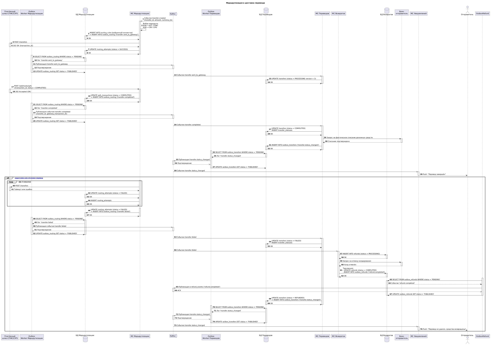

# Описание Kafka-контрактов для реализации функционала сервиса Трансграничных переводов

## 1. Введение

Документ представляет собой техническую спецификацию контрактов асинхронного взаимодействия микросервисов системы трансграничных переводов через Apache Kafka. Он описывает структуру и формат сообщений, топики, операции публикации и подписки, а также правила обработки ошибок.

Документ предназначен для команды разработки и команды тестирования.

Для гарантии доставки событий используется паттерн Outbox:

1. Событие записывается в таблицу outbox в той же транзакции, что и бизнес-операция
2. Outbox worker асинхронно публикует события в Kafka
3. При успешной публикации статус меняется на PUBLISHED
4. При ошибке - retry до 10 попыток, затем DLQ

## 2. Описание значимости артефакта

| Раздел | Содержание |
|--------|------------|
| Процесс и контекст использования | Этап проектирования событийной архитектуры |
| Цель создания | Зафиксировать структуру и формат сообщений в Kafka для асинхронного взаимодействия микросервисов при обработке переводов |
| Что становится определено | Формат сообщений в Kafka, топики, операции публикации и подписки |
| Пользователи артефакта | Бэкенд-разработчики, архитекторы, тестировщики |
| Использование в дальнейшем | Разработка бизнес-логики микросервисов, настройка топиков в Kafka |
| Последствия отсутствия | Высокий риск рассинхронизации контрактов между сервисами, дублирование или потеря событий при сбоях |

## 3. Sequence-диаграмма

**Участники**

1. МС Переводов — микросервис, отвечающий за создание и обработку переводов
2. БД Переводов — база данных сервиса Переводов
3. МС Маршрутизации — микросервис, отвечающий за выбор платёжного маршрута и отправку в шлюз
4. БД Маршрутизации — база данных сервиса Маршрутизации
5. МС Возвратов — микросервис, отвечающий за автоматический возврат средств
6. МС Уведомлений — микросервис, отвечающий за Push-уведомления
7. Apache Kafka — брокер сообщений
8. Банк-отправитель — система холдирования и списания средств



[Код диаграммы](КодДиаграммы.yml)

## 4. Спецификация на контракты Kafka. Топики transfer_events, transfer_status_changed, refund_events 

[Спецификация AsyncAPI](AsyncAPI.yml)

```yaml
asyncapi: 3.0.0
info:
  title: Система трансграничных переводов — Kafka Contracts
  version: 1.0.0
  description: |
    Асинхронные события, обеспечивающие взаимодействие микросервисов 
    системы трансграничных переводов через Apache Kafka.
    Гарантируется доставка at-least-once.
    Неподтверждённые события после 10 попыток попадают в DLQ 
      
channels:
  transfer_events:
    address: transfer_events
    description: |
      Основной топик для операционных событий жизненного цикла перевода.
      Потребители фильтруют сообщения по полю 'event_type' в payload
    messages:
      TransferEventMessage:
        $ref: '#/components/messages/TransferEventMessage'

  transfer_status_changed:
    address: transfer_status_changed
    description: |
      Топик для аудиторских событий изменения статуса перевода.
      Хранится 5 лет согласно требованиям ЦБ РФ и 152-ФЗ
    messages:
      TransferStatusChangedMessage:
        $ref: '#/components/messages/TransferStatusChangedMessage'

  refund_events:
    address: refund_events
    description: |
      Топик для событий процесса возврата средств
    messages:
      RefundEventMessage:
        $ref: '#/components/messages/RefundEventMessage'

operations:
  publishTransferEvent:
    action: send
    channel:
      $ref: '#/channels/transfer_events'
    summary: Публикация операционного события перевода
    description: МС Переводов или МС Маршрутизации публикует событие при изменении состояния перевода

  consumeTransferEvent:
    action: receive
    channel:
      $ref: '#/channels/transfer_events'
    summary: Обработка операционного события перевода
    description: МС Маршрутизации, МС Переводов или МС Возвратов обрабатывают событие в зависимости от 'event_type'

  publishTransferStatusChanged:
    action: send
    channel:
      $ref: '#/channels/transfer_status_changed'
    summary: Публикация события изменения статуса
    description: МС Переводов публикует событие при любом изменении статуса аудита и уведомлений

  consumeTransferStatusChanged:
    action: receive
    channel:
      $ref: '#/channels/transfer_status_changed'
    summary: Обработка события изменения статуса
    description: МС Уведомлений отправляет Push-уведомление пользователю

  publishRefundEvent:
    action: send
    channel:
      $ref: '#/channels/refund_events'
    summary: Публикация события возврата средств
    description: МС Возвратов публикует событие при инициации, завершении или ошибке возврата

components:
  messages:
    TransferEventMessage:
      name: TransferEventMessage
      title: Операционное событие перевода
      contentType: application/json
      headers:
        type: object
        required: [timestamp, message_id, idempotency_key]
        properties:
          timestamp:
            type: string
            format: date-time
            description: Дата и время публикации события 
          message_id:
            type: string
            format: uuid
            description: Уникальный идентификатор сообщения для сквозного логирования
          idempotency_key:
            type: string
            format: uuid
            description: Ключ идемпотентности для предотвращения дублирования 
      payload:
        $ref: '#/components/schemas/TransferEventPayload'

    TransferStatusChangedMessage:
      name: TransferStatusChangedMessage
      title: Событие изменения статуса перевода 
      contentType: application/json
      headers:
        type: object
        required: [timestamp, message_id, idempotency_key]
        properties:
          timestamp:
            type: string
            format: date-time
          message_id:
            type: string
            format: uuid
          idempotency_key:
            type: string
            format: uuid
      payload:
        $ref: '#/components/schemas/TransferStatusChangedPayload'

    RefundEventMessage:
      name: RefundEventMessage
      title: Событие возврата средств
      contentType: application/json
      headers:
        type: object
        required: [timestamp, message_id, idempotency_key]
        properties:
          timestamp:
            type: string
            format: date-time
          message_id:
            type: string
            format: uuid
          idempotency_key:
            type: string
            format: uuid
      payload:
        $ref: '#/components/schemas/RefundEventPayload'

  schemas:
    TransferEventPayload:
      type: object
      required: [event_type, transfer_id, user_id, created_at]
      properties:
        event_type:
          type: string
          enum: [transfer.created, transfer.sent_to_gateway, transfer.completed, transfer.failed]
          description: Тип события для маршрутизации внутри потребителя
        transfer_id:
          type: string
          format: uuid
          description: Уникальный идентификатор перевода 
        user_id:
          type: string
          format: uuid
          description: Внешний ID отправителя 
        amount:
          type: number
          description: Сумма перевода
        currency_from:
          type: string
          enum: [RUB]
          description: Валюта отправителя 
        currency_to:
          type: string
          enum: [KZT, CNY]
          description: Валюта получателя 
        exchange_rate:
          type: number
          description: Зафиксированный курс
        commission:
          type: number
          description: Комиссия за перевод
        total_amount:
          type: number
          description: Итоговая сумма к списанию
        status:
          type: string
          enum: [PENDING, APPROVED, PROCESSING, COMPLETED, BLOCKED, REJECTED, FAILED, MANUAL_REVIEW, REFUNDED]
          description: Текущий статус перевода
        country_to:
          type: string
          description: Страна получателя 
        beneficiary_id:
          type: string
          format: uuid
          description: Уникальный идентификатор бенефициара
        payment_purpose:
          type: string
          description: Цель платежа
        hold_expires_at:
          type: string
          format: date-time
          description: Время истечения холдирования средств
        fx_rate_expires_at:
          type: string
          format: date-time
          description: Время истечения периода зафиксированного курса
        connector_type:
          type: string
          enum: [SPFS, CIPS]
          description: Заполняется при event_type = sent_to_gateway, completed, failed
        gateway_transaction_id:
          type: string
          description: |
            Внешний ID транзакции в платёжной системе.
            Значение берётся из spfs_transactions.spfs_id или cips_transactions.cips_id
            в зависимости от поля connector_type
        error_code:
          type: string
          description: Заполняется при event_type = failed 
        error_message:
          type: string
          description: Заполняется при event_type = failed
        created_at:
          type: string
          format: date-time
          description: Дата создания перевода

    TransferStatusChangedPayload:
      type: object
      required: [transfer_id, user_id, old_status, new_status, changed_at]
      properties:
        transfer_id:
          type: string
          format: uuid
          description: Уникальный идентификатор перевода
        user_id:
          type: string
          format: uuid
          description: Внешний ID отправителя
        old_status:
          type: string
          enum: [PENDING, APPROVED, PROCESSING, COMPLETED, BLOCKED, REJECTED, FAILED, MANUAL_REVIEW, REFUNDED]
          description: Предыдущий статус
        new_status:
          type: string
          enum: [PENDING, APPROVED, PROCESSING, COMPLETED, BLOCKED, REJECTED, FAILED, MANUAL_REVIEW, REFUNDED]
          description: Новый статус
        reason:
          type: string
          description: Причина изменения статуса (из таблицы transfer_statuses)
        changed_at:
          type: string
          format: date-time
          description: Дата и время изменения

    RefundEventPayload:
      type: object
      required: [event_type, refund_id, transfer_id, user_id, created_at]
      properties:
        event_type:
          type: string
          enum: [refund.initiated, refund.completed, refund.failed]
          description: Тип события возврата
        refund_id:
          type: string
          format: uuid
          description: Уникальный идентификатор возврата 
        transfer_id:
          type: string
          format: uuid
          description: Уникальный идентификатор исходного перевода
        user_id:
          type: string
          format: uuid
          description: Внешний ID отправителя
        amount:
          type: number
          description: Сумма возврата
        currency:
          type: string
          enum: [RUB]
          description: Валюта возврата
        status:
          type: string
          enum: [PENDING, PROCESSING, COMPLETED, FAILED, ESCALATED]
          description: Текущий статус возврата
        reason:
          type: string
          description: Причина возврата
        attempt_count:
          type: integer
          description: Количество попыток возврата
        error_message:
          type: string
          description: Заполняется при event_type = refund.failed
        created_at:
          type: string
          format: date-time
          description: Дата создания записи о возврате
        updated_at:
          type: string
          format: date-time
          description: Дата последнего обновления записи о возврате

  correlationIds:
    transferCorrelationId:
      description: Идентификатор перевода для сквозного отслеживания
      location: $message.payload#/transfer_id