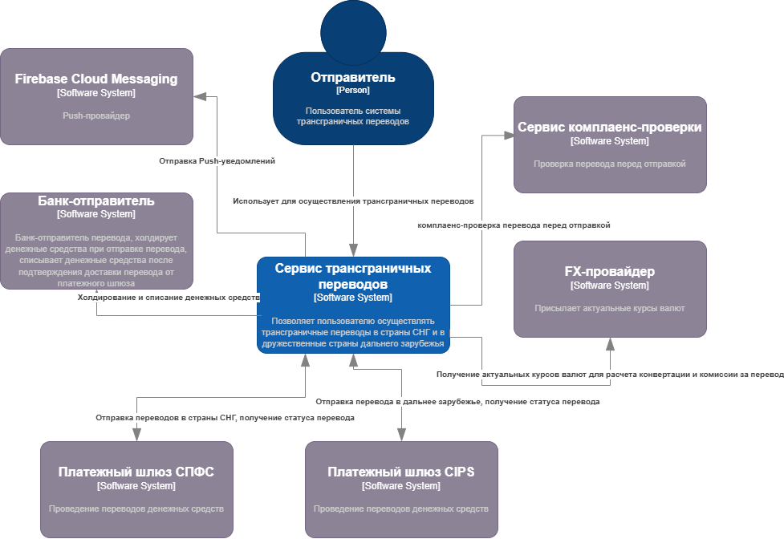
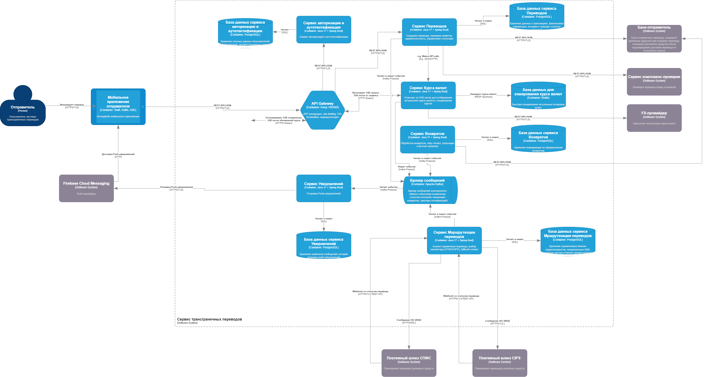
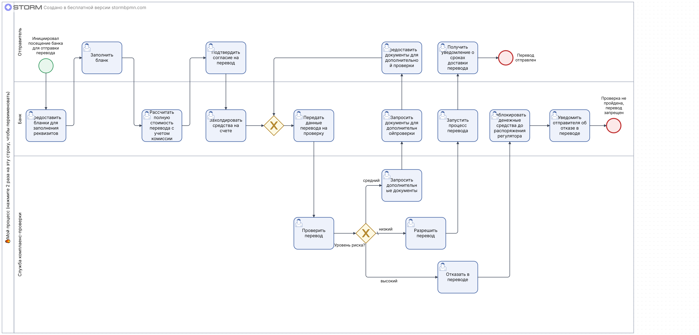
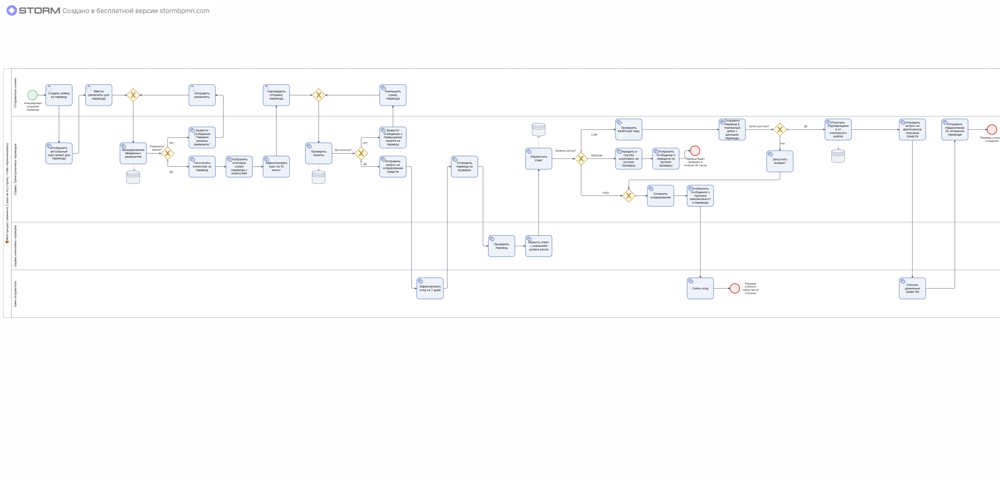

# Vision-документ сервиса трансграничных переводов

## 1. Введение

### 1.1. Назначение документа

Настоящий документ описывает бизнес-видение, предметную область, границы продукта, функциональные и нефункциональные требования, ключевые бизнес-процессы, архитектурный контур и критерии успеха для продукта «Трансграничные переводы» - цифрового сервиса в мобильном приложении банка, который позволяет клиентам осуществлять денежные переводы резидентам Казахстана и Китая в несколько кликов.

Документ создаётся для того, чтобы все участники проекта имели единое понимание:

* зачем создаётся продукт
* какую проблему он решает
* кто им пользуется
* как он должен вести себя
* какие ограничения и риски необходимо учитывать

### 1.2. Бизнес-контекст

С 2022 года ряд международных платёжных систем (SWIFT, Visa, Mastercard) ограничил обслуживание российских банков. Это создало системную проблему для физических лиц, которым необходимо переводить денежные средства резидентам стран СНГ и дальнего зарубежья — в частности, Казахстана и Китая, являющихся ключевыми торгово-экономическими партнёрами РФ.

**Ключевые проблемы текущего состояния:**

1. Отсутствие единого цифрового канала для трансграничных переводов
2. Необходимость личного посещения банка и заполнения бумажных документов
3. Длительные сроки проведения платежей (до 5–7 рабочих дней)
4. Непрозрачность статусов и комиссий
5. Сложность прохождения комплаенс-проверок
6. Отсутствие автоматического возврата средств при ошибках

**Решение банка:** создать собственный цифровой сервис, который автоматизирует все этапы:

1. Отображение актуального валютного курса в реальном времени
2. Валидацию реквизитов бенефициара
3. Автоматическую комплаенс-проверку
4. Маршрутизацию через доступные платёжные системы (СПФС, CIPS)
5. Уведомления о статусе перевода
6. Автоматический возврат средств при невозможности проведения

### 1.3. Границы

**Входит в систему:**

1. Создание отправителем заявки на трансграничный перевод
2. Отображение актуального валютного курса и расчёт комиссии
3. Проверка лимитов отправителя (суточный, месячный)
4. Холдирование средств на счёте отправителя
5. Автоматическая комплаенс-проверка
6. Маршрутизация платежа через СПФС или CIPS
7. Обработка вебхуков от платёжных шлюзов
8. Автоматический возврат средств при ошибках
9. Push-уведомления об изменении статуса
10. Просмотр истории переводов

**За рамками системы:**

1. Регистрация и KYC-верификация пользователей (делегировано основной системе банка)
2. Реализация бизнес-логики комплаенс-проверки и скоринга
3. Актуализация санкционных списков
4. Интеграция с криптовалютными биржами
5. Массовые корпоративные переводы
6. Переводы в страны, не поддерживаемые на MVP 

### 1.4. Термины и сокращения

| Термин | Описание |
| ------ | ---------- |
| Трансграничный перевод | Перевод денежных средств между резидентами разных стран |
| Отправитель | Пользователь системы, инициирующий перевод |
| Бенефициар | Конечный получатель перевода |
| СПФС | Система передачи финансовых сообщений (аналог SWIFT для РФ) |
| CIPS | Cross-Border Interbank Payment System (китайская система межбанковских расчётов) |
| Холдирование | Резервирование средств без фактического списания |
| Комплаенс-проверка | Оценка легальности денежных переводов и их проверка на отсутствие признаков финансовых преступлений до момента фактического списания средств |

## 2. Стратегическое видение

### 2.1. Бизнес-цели

| Цель | Метрика | Целевое значение | Срок |
| ------- | ------ | ----- | ----- |
| Удержание клиентов в экосистеме банка | Доля клиентов, использующих сервис| 15% от активной базы | 12 мес |
| Рост транзакционной активности | Объём переводов | 1 млрд RUB в месяц | 12 мес |
| Скорость проведения перевода | Среднее время от создания до COMPLETED | < 24 часов | 6 мес |
| Прозрачность процесса | Доля переводов с актуальным статусом | 100% | 3 мес |
| Снижение операционных издержек | Доля автоматических возвратов | > 95% | 6 мес |

### 2.2. Ценностное предложение 

| Для клиента | Для банка |
| ---------- | ---------- |
| Переводы в Казахстан и Китай из мобильного приложения за несколько минут | Удержание клиентов в экосистеме банка |
| Актуальный курс валют в реальном времени с прозрачной комиссией | Рост комиссионного дохода |
| Автоматическая комплаенс-проверка без визита в офис | Снижение операционных издержек |
| Push-уведомления на каждом этапе | Конкурентное преимущество |
| Автоматический возврат средств при невозможности перевода | Соответствие требованиям ЦБ РФ и 152-ФЗ |
| История всех переводов в одном месте | Аналитика по транзакционной активности |

## 3. Заинтересованные стороны и пользователи

### 3.1. Стейкхолдеры

| Стейкхолдер | Роль | Интерес |
| ---- | ---- | ---- |
| Владелец продукта | Бизнес-сторона | Успешный запуск, удовлетворённость клиентов | 
| Руководство банка | Бизнес-сторона | Окупаемость инвестиций, рост транзакционной активности |
| Руководитель проекта | Бизнес-сторона | Соблюдение сроков и бюджета |
| Системный архитектор | Команда | Микросервисная архитектура, масштабируемость, интеграции |
| Бизнес-аналитик | Команда | Полнота и корректность требований |
| Backend-разработчики | Команда | Понятные API-контракты, управляемая сложность |
| DevOps-инженер| Команда | Надёжное развёртывание, мониторинг, инфраструктура |
| QA-инженеры | Команда | Покрытие тестами, критерии приёмки |
| Клиенты банка | Внешние | Простой и быстрый способ перевода |
| Комплаенс-служба | Внешняя | Соответствие AML/CFT требованиям |
| ЦБ РФ | Регулятор | Соответствие требованиям по хранению данных и отчётности |

### 3.2. Целевая аудитория

| Сегмент | Описание | Потребности |
| ---- | ---- | ----|
| Трудовые мигранты | Граждане РФ, работающие с партнёрами в KZ/CN | Быстрые переводы с минимальной комиссией |
| Студенты и их родители | Оплата обучения за рубежом | Прозрачность курса и сроков |
| Малый бизнес | Расчёты с контрагентами в СНГ | Надёжность и предсказуемость |
| Частные лица | Поддержка родственников за рубежом | Простота и доступность |

## 4. Ключевые возможности продукта

* Создание перевода

Описание: Отправитель создаёт заявку на перевод с указанием страны, валюты, суммы, реквизитов бенефициара и цели платежа. Система валидирует данные и фиксирует курс на 15 минут

* Отображение курса в реальном времени

Описание: SSE-поток транслирует актуальный курс валютной пары с обновлением не чаще 1 раза в 30 секунд. Комиссия пересчитывается автоматически

* Проверка лимитов

Описание: Система проверяет суточный (100 000 RUB) и месячный (1 000 000 RUB) лимиты перед созданием перевода

* Холдирование средств

Описание: При создании перевода средства резервируются на счёте отправителя на срок до 7 дней

* Комплаенс-проверка

Описание: Автоматическая проверка перевода внешним сервисом

* Маршрутизация платежа

Описание: Автоматический выбор платёжного маршрута: RUB→KZT через СПФС, RUB→CNY через CIPS

* Автоматический возврат средств

Описание: При невозможности проведения перевода система автоматически возвращает средства

* Push-уведомления

Описание: Уведомления об изменении статуса перевода на каждом этапе

* История переводов

Описание: Просмотр списка и деталей переводов с фильтрацией по статусу и дате

## 5. Архитектура C4

### 5.1. Уровень 1: Контекст

### 5.2. Уровень 2: Контейнеры

**Архитектурная стратегия**

Для сервиса трансграничных переводов выбрана микросервисная архитектура, потому что:

* Независимое масштабирование - каждый сервис можно масштабировать отдельно в зависимости от нагрузки
* Разделение ответственности - каждый сервис отвечает за свою доменную область
* Технологическая гибкость - возможность использовать разные технологии для разных сервисов
* Отказоустойчивость - сбой одного сервиса не влияет на другие
* Интеграция с внешними системами — каждый сервис может иметь свою интеграцию

**Ключевые архитектурные решения:**

* API Gateway - единая точка входа, маршрутизация, аутентификация через JWT
* Apache Kafka - асинхронная обработка событий, гарантия доставки at-least-once
* SSE - передача актуальных курсов валют в реальном времени
* PostgreSQL - реляционная БД для каждого сервиса
* Redis - кэширование курсов валют для SSE
* Idempotency-Key - защита от дублирования финансовых операций
* Circuit Breaker - защита от каскадных сбоев при недоступности внешних сервисов

## 6. BPMN-модель бизнес-процесса

### 6.1. Модель AS IS

**Описание текущего процесса:** Трансграничные переводы выполняются через посещение банка, заполнение бумажных документов, ручную комплаенс-проверку и ожидание в течение нескольких дней без прозрачности статусов

**Проблемы текущего процесса:**

| Проблема | Описание | Влияние |
| ---- | ----- | ----|
| Ручное оформление | Необходимость личного визита в банк и заполнения бумажных документов |Высокие трудозатраты, потеря времени
| Отсутствие прозрачности | Невозможность отследить статус перевода в реальном времени | Тревожность клиента, повторные обращения в поддержку |
| Длительные сроки | Перевод занимает 5–7 рабочих дней | Недовольство клиентов, отток к конкурентам |
| Ошибки комплаенс | Ручная проверка, высокий процент отказов без объяснения причин | Потеря клиентов, репутационные риски |
| Сложность возврата средств | Возврат средств при ошибках требует ручного вмешательства | Длительные сроки возврата, жалобы |

### 6.2. Модель TO BE

**Описание:** Процесс полностью автоматизирован через мобильное приложение с интеграцией платёжных систем СПФС и CIPS, автоматической комплаенс-проверкой и push-уведомлениями

**Улучшения и выгоды:**

| Улучшение | Как реализовано | Выгода |
| ---- | ---- | ---- |
| Цифровой канал | Мобильное приложение с SSE для курсов |Перевод за несколько минут без визита в банк |
| Автоматическая комплаенс-проверка |Интеграция с внешним сервисом проверки | Мгновенное решение, прозрачные причины отказа |
| Автоматическая маршрутизация | Правила RUB→KZT (СПФС), RUB→CNY (CIPS) | Оптимальный маршрут без участия клиента |
| Прозрачность статусов | Push-уведомления на каждом этапе | Клиент всегда знает статус перевода |
| Автоматический возврат средств при невозможности перевода | Retry-логика с эскалацией | Средства возвращаются без обращения в поддержку |

## 7. Критерии успеха и метрики

**Бизнес-метрики**

| Показатель | Описание | Целевое значение |
| ---- | ---- | ---- |
| Количество переводов | Число успешно завершённых переводов | 50 000 в месяц |
| Объём переводов | Сумма всех переводов | 1 млрд RUB в месяц |
| Среднее время перевода | От создания до COMPLETED | < 24 часов |
| Доля автоматических возвратов | Возвраты без ручного вмешательства | > 95% |
| NPS | Индекс лояльности клиентов | > 50 |
| Доля успешных переводов | Общее количество | > 90% |

## 8. Нефункциональные ожидания верхнего уровня

| Категория | Ожидание | Целевое значение |
| ---- | ---- | ---- |
| Производительность | Время ответа API создания перевода | < 500 мс (p95) |
| Производительность | Время ответа API списка переводов | < 300 мс (p95) |
| Производительность | Время обработки вебхука | < 200 мс |
| Производительность | Пропускная способность | ≥ 100 RPS |
| Доступность | Время доступности системы | 99.9% |
| Доступность | Время восстановления (RTO) | ≤ 30 минут |
| Надёжность | Потеря данных | 0 минут (WAL-архивирование) |
| Надёжность | Гарантия доставки событий | at-least-once через Kafka |
| Безопасность | Шифрование данных при передаче | TLS 1.3 |
| Безопасность | Защита от повторов | Idempotency-Key (UUID) |
| Масштабируемость | Одновременные пользователи | до 10 000 |
| Аудит | Срок хранения логов | 5 лет (ЦБ РФ, 152-ФЗ) |

## 9. Риски и ограничения

### 9.1. Риски

| Риск | Вероятность | Влияние | Меры по снижению | Ответственный |
| --- | -- | -- | ---   | --- |
| Техническая интеграция с платёжными шлюзами | Высокая | Высокое | Чёткие контракты API, пилотные интеграции | Системный архитектор |
| Недоступность внешних сервисов (СПФС, CIPS) | Средняя | Высокое | Circuit Breaker, retry policies, DLQ | Backend-разработчики |
| Регуляторные изменения | Средняя | Высокое | Гибкая архитектура, мониторинг изменений | Бизнес-аналитик |
| Принятие пользователями | Средняя | Среднее | Интуитивный интерфейс, push-уведомления | Владелец продукта |
| Сбои комплаенс-проверки | Низкая | Высокое | Fallback на MANUAL_REVIEW, эскалация | Комплаенс-служба |

### 9.2. Ограничения

**Бизнес-ограничения:**

* Только переводы в KZ и CN на MVP
* Только физические лица (резиденты РФ)
* Лимиты: 100 000 RUB суточный, 1 000 000 RUB месячный
* Срок хранения данных: 5 лет (требование ЦБ РФ)

**Технические ограничения:**

* SWIFT недоступен для российских банков
* Поддерживаемые валюты: RUB, KZT, CNY
* Курс фиксируется на 15 минут
* Срок холдирования: 7 дней

## 10. Критерии приёмки

### 10.1. Условия готовности системы

Система считается готовой, если реализованы все обязательные сценарии и они работают end-to-end:

1. Клиент может создать перевод с указанием реквизитов бенефициара
2. Система проверяет лимиты и холдирует средства
3. Комплаенс-проверка возвращает результат (LOW/MEDIUM/HIGH)
4. Перевод маршрутизируется через СПФС или CIPS
5. Вебхук от платёжного шлюза обновляет статус перевода
6. Push-уведомление отправляется клиенту
7. При ошибке — автоматический возврат средств
8. Клиент видит историю переводов с актуальными статусами

### 10.2. Критерии приёмки бизнесом

1. Перевод можно создать и отправить
2. Курс отображается в реальном времени
3. Лимиты проверяются корректно
4. Комплаенс-проверка работает автоматически
5. Уведомления отправляются на каждом этапе
6. Возврат средств происходит автоматически при ошибках
7. История переводов отображается корректно

### 10.3. Критерии приёмки QA

1. Тесты по основным сценариям пройдены
2. Нет критических дефектов
3. Ошибки обрабатываются корректно
4. Идемпотентность работает (дубликаты не создаются)
5. Валидация реквизитов бенефициара работает
6. Нагрузочное тестирование: 100 RPS, p95 < 500 мс
